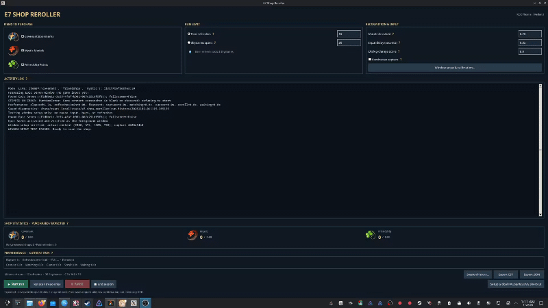

# E7 Shop Reroller — KDE Plasma Wayland



An unofficial Secret Shop reroll assistant for the PC edition of E7. It detects
Covenant Bookmarks, Mystic Medals, and Friendship Points, automates selected
purchases and refreshes, and records session statistics.

**Publisher notice:** This project is not endorsed by Smilegate. The game's
published terms restrict unauthorized automation tools. Use may put your game
account at risk; review those terms before deciding whether to use the app.

## Platform compatibility

E7 Shop Reroller is a **Linux application designed for KDE Plasma on Wayland**,
not an Arch-specific application. Its Python runtime uses KDE/KWin interfaces,
`kdotool`, `ydotool`, Spectacle, and optionally PipeWire.

- **Tested:** Arch Linux with KDE Plasma Wayland and the PC edition of E7
  through Steam/Proton, at 1280×720 and approximately 1008×567 game content.
- **Packaged:** Prebuilt **x86-64 Arch Linux** package (`.pkg.tar.zst`).
  The instructions below are for Arch Linux and Arch-based distributions.
- **Other distributions:** KDE Wayland systems such as Fedora KDE, openSUSE,
  or Kubuntu may be compatible, but have **not been tested or packaged**.
  They require their own dependency setup; the Arch package cannot be
  installed with `dnf`, `zypper`, or `apt`.
- **Not verified:** Steam Deck/SteamOS, fractional display scaling, and 1080p
  game setups. Displays unable to fit at least 960×540 game content plus
  decorations are unsupported (including 800×480).

Supervise all live runs. GNOME Wayland and X11 are not supported.

## Download & Install (Arch Linux package)

**Recommended for Arch Linux:** Install the prebuilt package from the latest
[GitHub release](https://github.com/TemperedTyrant/e7-shop-reroller/releases/latest).

**Requirements:** x86-64 Arch Linux or an Arch-based distribution using KDE
Plasma Wayland, the PC edition of E7 through Steam/Proton, and a working
`ydotoold` input daemon.

1. **Download two files** from the release page's **Assets** section:
   - `e7-shop-reroller-1.1.0-1-x86_64.pkg.tar.zst` (the application)
   - `package.sha256` (download verification)

   Choose the package, **not** the "Source code" ZIP or tarball.

2. **Install the input tools.** `ydotool` is in Arch's official repositories;
   `kdotool` comes from the AUR:

   ```sh
   sudo pacman -S --needed ydotool
   paru -S kdotool
   ```

   The second command assumes you have [paru](https://github.com/Morganamilo/paru).
   Otherwise install `kdotool` using your usual
   [AUR build method](https://wiki.archlinux.org/title/Arch_User_Repository).

3. **Enable and start ydotool's user service** (run as your normal user,
   **without `sudo`**):

   ```sh
   systemctl --user enable --now ydotool.service
   systemctl --user status ydotool.service
   ```

   Confirm it reports **active (running)**. The service launches `ydotoold`
   and starts automatically when your user session starts. If it fails,
   inspect `journalctl --user -u ydotool.service` for input-device or
   permission errors. Avoid running the application or input daemon as root.

4. **Verify the package** in the folder containing both downloads
   (typically `~/Downloads`):

   ```sh
   cd ~/Downloads
   sha256sum --check package.sha256
   ```

   Confirm the package reports **OK**.

5. **Install the package**:

   ```sh
   sudo pacman -U ./e7-shop-reroller-1.1.0-1-x86_64.pkg.tar.zst
   ```

   Pacman resolves the other declared dependencies.

6. **Launch and calibrate.** Open **E7 Shop Reroller** from the application
   menu (or run `e7-shop-reroller`). Use **Window setup & calibration… →
   Test Window Setup** before a live run, and follow the on-screen guide
   to configure a global Pause/Resume shortcut.

**Updates:** GitHub release packages are installed manually; they do not
automatically update through pacman or an AUR helper. Download and install
the latest release package when upgrading. The package is currently unsigned,
so verify its checksum and download it from this project's official release page.

### Build from source (optional)

Developers or users who prefer local builds can use:

```sh
sudo pacman -S --needed base-devel ydotool
paru -S kdotool
git clone https://github.com/TemperedTyrant/e7-shop-reroller.git
cd e7-shop-reroller
bash arch/build-local.sh
```

Before launching a locally built installation, also run
`systemctl --user enable --now ydotool.service` as described above.
The script makes a local source archive and runs `makepkg -si`. It runs the
offline regression tests during packaging; tests are not installed with the
application.

## Usage

1. Open the Secret Shop at the top of the list.
2. Choose items and **one** limit: paid refreshes or Skystones spent.
3. Use **Window setup & calibration… → Test Window Setup** to verify geometry
   without buying or refreshing.
4. Use **Test scan (read-only)** to check detection without mouse input.
5. Select **Start run**, read the spending confirmation, and supervise the game.

The app activates, sizes and positions the game window before running. It
scans upper and lower items, buys selected rows, then refreshes for 3 Skystones.
The final refreshed shop **is scanned**: 10 paid refreshes review 11 shops.

Purchase verification requires the row availability area to change and its
Buy label to become disabled (the expected `1/1` → `0/1` transition). This is
not digit OCR or independent inventory/Gold verification. Inconclusive actions
pause for manual inspection. Use **Pause** at a safe checkpoint, **Resume**
after resolving the problem, or **End session** to terminate.

### Recognition & Input

Hover over a **?** next to a setting for help.

| Setting | Meaning |
| --- | --- |
| Match threshold (`0.70`) | Minimum image-match confidence. Lower values risk false positives; higher values can miss items. |
| Input delay (`0.35 s`) | Wait after each click; supported `0.20–10 s`. The minimum `0.20 s` has been tested. |
| Dialog-change score (`8.0`) | Required visual difference to recognize a Buy/Refresh dialog transition. |
| Continuous capture | Checked uses a PipeWire window stream (fast); unchecked takes individual Spectacle screenshots (slower). |

When KDE asks what to share, select the **game window**, not the monitor.
The stream is checked against a Spectacle image before use.

### Display compatibility

Window setup targets 1280×720 content when it fits, otherwise uses a smaller
16:9 rectangle on the monitor currently containing Epic Seven. Recognition
templates scale with the measured content width. The game must fit at least
960×540 plus window decorations. Small KWin positioning adjustments are
accepted only after verified screenshot geometry; unsupported layouts stop
before sending clicks. Fractional KDE scaling and Steam Deck remain unverified.

### Offline tests (source checkout)

On Arch, install the PKGBUILD's Python runtime dependencies, then run:

```sh
python -B -m unittest discover -s tests -v
```

Tests do not launch the game or send mouse input. They cover limit arithmetic,
expected values, dynamic scaling, monitor selection, and synthetic template
matching including duplicate currency offers and Buy label states. Recognition
tests require OpenCV; if missing, they report **skipped**. A GitHub Actions job
installs these dependencies before running the complete suite. Manual live
testing is still required for KWin, PipeWire, clicking, and actual game animations.

### Arch release builds (GitHub Actions)

**To publish a new version**, first add its release notes to `CHANGELOG.md`
under an unreleased heading such as `## 1.1.0 — Unreleased` and merge them
into `main`. Then run **Actions → Prepare and publish version → Run workflow**
from `main` and enter the version **without** `v` (for example `1.1.0`).

The workflow updates the local and AUR package versions, commits the tagged
source, computes the GitHub archive SHA256, and pins the verified checksum in
a follow-up `main` commit. A second job runs the offline tests and builds the
Arch package. **Only after the package passes verification** does it create
and publish the GitHub release with the package and checksum attached.

Release tags cannot safely contain their own archive SHA256 because that
would change the archive hash. For that reason, use the *post-tag* pinned
`arch/PKGBUILD.aur.template` from `main` when submitting to AUR. The tag
itself contains the placeholder that was used before the checksum existed.

The separate **Actions → Build Arch release package → Run workflow** remains
available to rebuild an existing published release (for example `v1.0.0`).
It also runs for independently published releases, but pushes of tags by
themselves no longer trigger it. Rebuilds refuse to replace existing assets.
GitHub Actions uses an **unsigned** `.pkg.tar.zst` and `package.sha256`;
the build artifact also includes `.SRCINFO` and is retained for 30 days.

The automated release requires workflow permission to create commits and tags
on `main`. Branch rules that restrict GitHub Actions from pushing will
prevent automated release preparation; do not bypass those protections
silently. It does not submit to AUR. GitHub release packages are not a
pacman repository and do not provide automatic updates.

The build uses an official Arch Linux container. CI skips the check that all
AUR runtime dependencies are installed, because `kdotool` is not in Arch's
official repositories; the generated package retains its declared `kdotool`
dependency. The offline tests still run with system OpenCV. A real KDE
Wayland session is required for live end-to-end verification.

### KDE global shortcut

Bind a **Command or Script** shortcut in **KDE System Settings → Keyboard →
Shortcuts** to `/usr/bin/e7-shop-reroller-toggle`, optionally using
`Ctrl+Alt+Shift+F12` if available. The shortcut toggles
Pause/Resume for an *active* session; it does not start a session.

KDE supports application-provided shortcuts, but this version does not claim
or overwrite any key combinations automatically.

## Data, history and exports

User data is stored in XDG directories:

| Data | Default path |
| --- | --- |
| Settings | `~/.config/e7-shop-reroller/settings.json` |
| Session history | `~/.local/state/e7-shop-reroller/history.sqlite3` |
| Diagnostic folders | `~/.local/state/e7-shop-reroller/run-history/` |

The app honors XDG config/state overrides. Package upgrades preserve data.
**Session history…** lists saved runs. The existing **Export CSV/JSON** buttons
save one summary per run, including actual and expected counts for all three
currencies.

**Planned for v1.1:** Double-click a run (or select **View details**) to view
its shop-by-shop results. New sessions store confirmed purchases, detected offers
and their outcomes, scan durations, and refresh durations. **Detailed CSV/JSON**
exports include shop information for all runs; the individual details window can
export only the selected run. CSV has one row per detected offer and a placeholder
row for empty shops; JSON nests shops and offers within their session.

The SQLite upgrade preserves old summaries, but runs recorded before v1.1 have
no shop-level data. Their previously saved expected counts are not recalculated.
**Clear history & data…** lets you separately remove session records (including
shop details), diagnostic folders, or preferences. Deletion needs confirmation
and cannot run during an active session.

Performance statistics show elapsed time, refreshes/minute, frame count and
capture/recognition/cursor/scroll/waiting totals, with display units adapting
automatically from seconds to minutes to hours. Raw export timings remain seconds.

Expected item counts use the published Level 13 per-slot rates (Covenant
0.6602509%, Mystic 0.1700646%, Friendship 19.1772874%) and the **provisional**
probability of at least one occurrence across six slots:
shops × (1 - (1 - rate)^6). This assumes at most one offer per currency per
shop and is not a confirmed game-generation rule or a guarantee.

## Source and licensing

The runtime uses Python, Tkinter, OpenCV, PipeWire/GStreamer, Spectacle, KWin
and ydotool. The original recognition templates in `assets/` remain unchanged;
transparent `assets/gui/` icons are display-only.

This is a standalone Linux application **based on**
[Solunium/Epic-Seven-E7-Secret-Shop-Refresh](https://github.com/Solunium/Epic-Seven-E7-Secret-Shop-Refresh),
not a GitHub fork of that repository. It retains the original project's recognition
image templates and overall shop-rerolling concept; the KDE Wayland integration,
window management, GUI, run controls, session statistics and packaging were
substantially reworked for this project. Credit to the original contributors
is retained, and their GPL obligations remain applicable to any reused code.

The **application code** is distributed under the GNU General Public License
version 3 (`GPL-3.0-only`); see [LICENSE](LICENSE). You may use, inspect, modify
and redistribute covered code under its terms, including making modified
source available when distributing derivatives. The license does not grant
rights to third-party game artwork or endorse the use of automation.

`arch/PKGBUILD` is the **local development build** and intentionally uses a
local archive and `SKIP` checksum. For a tagged source archive, use `arch/PKGBUILD.aur.template` from the
current `main` branch after its checksum is verified against the final tag.
Copy it to `PKGBUILD` when preparing an AUR submission and generate `.SRCINFO`
with `makepkg --printsrcinfo > .SRCINFO`.
